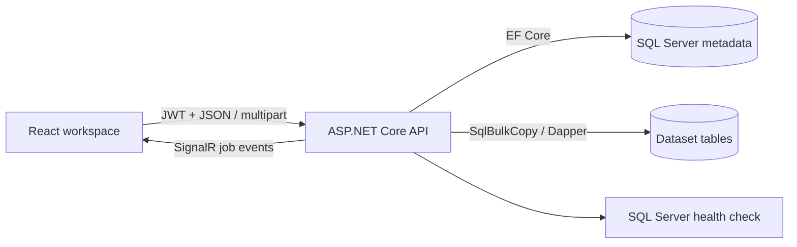
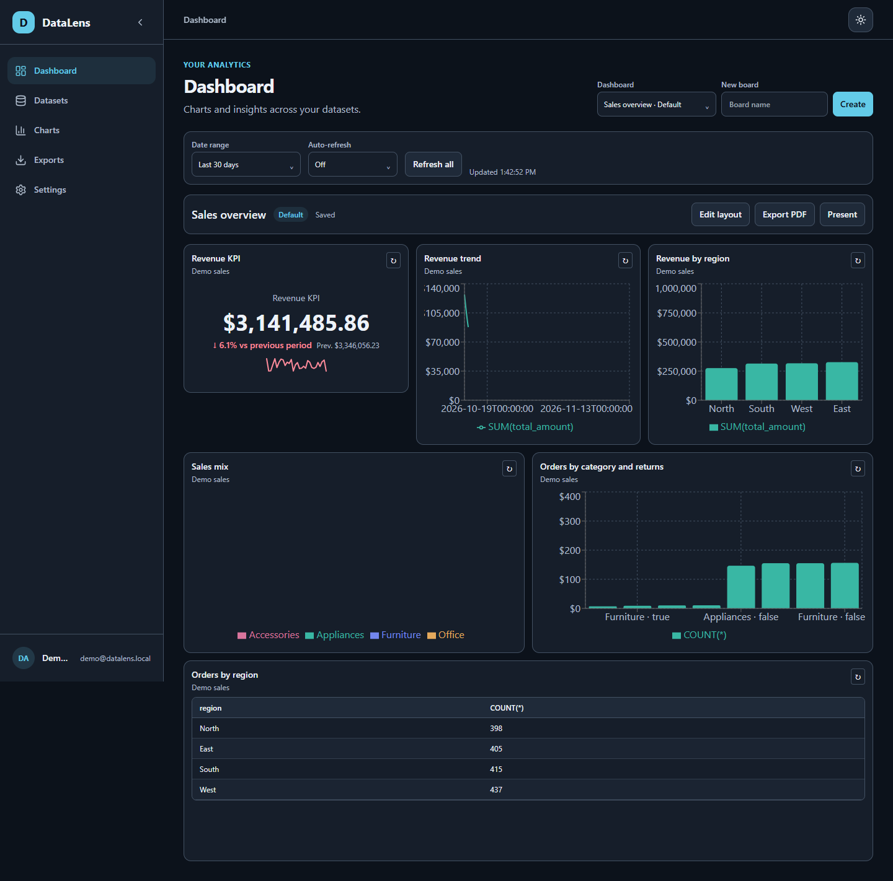
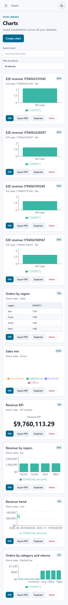
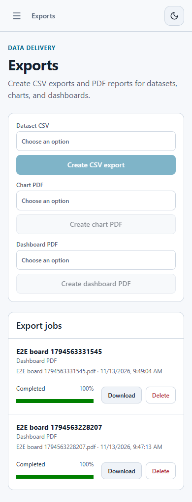

# DataLens

DataLens is a .NET 8 + React project for importing, inspecting, and analyzing CSV datasets. It includes account registration/login, owner-scoped datasets, asynchronous CSV imports to dataset-specific SQL Server tables, paged previews, reusable saved charts, and dashboards that compose charts across datasets.

## Requirements

- .NET 8 SDK
- Node.js 20+
- SQL Server LocalDB, Express, or Developer Edition

No containers are required.

## Run locally

1. Start the `MSSQLLocalDB` instance if needed:

```powershell
sqllocaldb start MSSQLLocalDB
```

2. The development connection string is in `backend/DataLens.Api/appsettings.Development.json`:

```json
{
  "ConnectionStrings": {
    "DefaultConnection": "Server=(localdb)\\MSSQLLocalDB;Database=DataLens;Trusted_Connection=True;MultipleActiveResultSets=true;TrustServerCertificate=True"
  }
}
```

Replace it with a SQL Server Express/Developer connection string if LocalDB is unavailable. The API applies EF Core migrations automatically only in Development. Configure `Jwt:SigningKey` with a private value of at least 32 characters outside Development.

3. Start the API:

```powershell
cd D:\DataLens\backend
dotnet restore DataLens.slnx
dotnet run --project DataLens.Api
```

The API listens on `http://localhost:5000`. Swagger is available at `/swagger`, and the SQL Server health check is at `/health`.
If sign-up or sign-in shows that the API is unavailable (or a 502 response), keep this API process running and verify `http://localhost:5000/health` before retrying from the frontend.

To save the current Swagger document to `backend/openapi.json`, keep the API running and execute:

```powershell
.\backend\scripts\export-openapi.ps1
cd D:\DataLens\frontend
npm run api:types
```

The second command regenerates `frontend/src/lib/openapi.generated.ts` from the saved API contract.

4. In a second terminal, start the frontend:

```powershell
cd D:\DataLens\frontend
npm ci
npm run dev
```

Open `http://localhost:5173`, select **Launch dashboard**, create an account, and import a `.csv` file (up to 200 MB by default). The workspace routes are `/` (dashboard), `/datasets`, `/charts`, and `/datasets/{id}`. Create a chart from the Charts page or directly from a dataset, then add saved charts from any dataset to a dashboard. Dashboard layout changes use optimistic concurrency and report conflicts rather than overwriting another session's changes. Set `Uploads:MaxFileSizeBytes` for the server and `VITE_MAX_UPLOAD_BYTES` in `frontend/.env` to the same byte count to change the limit. `ImportJobs:QueueCapacity` and `ImportJobs:Concurrency` configure the bounded in-memory worker queue; `Uploads:StoragePath` can set the directory used for queued source files. Vite proxies `/api`, `/health`, and the SignalR `/hubs` endpoint to the backend.

Use `samples/sales.csv` for a small import, or generate a larger file with `.\samples\generate-large-csv.ps1 -Size 1m`.

## Current API surface

- `POST /api/auth/register`, `POST /api/auth/login`, `GET /api/auth/me`
- `GET /api/dashboard/summary`
- `GET /api/datasets`, `POST /api/datasets`, `GET /api/datasets/{id}`
- `GET /api/datasets/{id}/preview?page=1&pageSize=50&sortBy=Amount&sortDirection=desc`
- `PUT /api/datasets/{id}/columns/{position}`
- `POST /api/datasets/{id}/analytics`
- `GET|POST /api/charts`, `GET|PUT|DELETE /api/charts/{id}`
- `POST /api/charts/preview`, `GET /api/charts/{id}/preview`
- `POST /api/exports/charts/{chartId}`, `POST /api/exports/dashboards/{dashboardId}`
- `GET /api/exports`, `GET /api/exports/{id}`, `GET /api/exports/{id}/download`, `DELETE /api/exports/{id}`
- `GET|POST /api/dashboards`, `GET|PUT|DELETE /api/dashboards/{id}`
- `POST /api/dashboards/{id}/default`
- `POST /api/dashboards/{id}/widgets`, `DELETE /api/dashboards/{id}/widgets/{widgetId}`
- `PUT /api/dashboards/{id}/layout`
- `GET|POST /api/datasets/{id}/reports`
- `PUT|DELETE /api/datasets/{id}/reports/{reportId}`
- `POST /api/datasets/{id}/reports/{reportId}/run`
- `GET /api/datasets/{id}/import-errors`, `GET /api/datasets/{id}/import-errors.csv`
- `DELETE /api/datasets/{id}`
- `GET /api/import-jobs`, `GET /api/import-jobs/{id}`
- `POST /api/import-jobs/{id}/cancel`, `POST /api/import-jobs/{id}/retry`
- SignalR hub: `/hubs/jobs` (`JobProgress`, `JobCompleted`, `JobFailed`, `JobCancelled`)

Protected endpoints require `Authorization: Bearer <access-token>`. Dataset uploads return HTTP 202 with a job and dataset ID; job status is available by API and through owner-scoped SignalR notifications, with polling as a frontend fallback. Imports infer text, integer, decimal, boolean, date, and datetime types from up to 5,000 rows, accepting a typed value when at least 95% of non-empty samples parse. Invalid rows are skipped and recorded with row/column/value/reason details; the import report supports pagination and CSV download. Each dataset uses a GUID-derived `[data].[ds_<id>]` table with generated `[c0]`, `[c1]`, … identifiers, so CSV headers never become SQL identifiers.

Dataset details include a paginated, virtualized preview with server-side sorting and editable column labels. Chart queries support multiple group-by columns, metrics, AND filters, time buckets, sorting, and top-N. The chart editor offers bar, horizontal/stacked bar, line/multi-line, area/stacked area, pie, donut, scatter, KPI, and table presentations; chart previews expose cache status and duration, table output, and CSV/PNG export actions. Dashboards compose charts from different datasets, support layout presets, keyboard move controls, default-board selection, and independently loaded widgets. Saved charts and dashboards are owner-scoped; dashboards use rowversion-backed batch layout updates and return HTTP 409 for stale versions. Query identifiers are derived only from validated dataset column positions and filter values are parameterized.

On upgrade, the `SavedChartsAndDashboards` migration copies existing `SavedReports` into `SavedCharts`, retaining the old rows and API for backward compatibility. The old reports panel is removed from the dataset page.

The queue is in memory: queued/running jobs are marked failed on restart and can be retried while their source file remains available. Failed/cancelled source files are retained for retry; successful imports remove their source file.

Chart and dashboard PDF requests use the same background export queue and appear in Exports with progress and download/delete actions. Each PDF contains chart metadata, KPI comparison details when applicable, and the live query results as accessible tables. PDF jobs retain their target name and optional date range; deleting a chart or dashboard clears export references without deleting completed report files.

## Tests

```powershell
cd D:\DataLens\backend
dotnet test DataLens.Tests\DataLens.Tests.csproj

cd D:\DataLens\frontend
npm run lint
npm run test
npm run build

# With the Development API/LocalDB and Vite running, plus Chrome installed:
$env:CHROME_EXECUTABLE = "C:\Program Files\Google\Chrome\Application\chrome.exe"
npm run e2e -- --workers=1

# Backend coverage:
cd D:\DataLens\backend
dotnet test DataLens.Tests\DataLens.Tests.csproj --no-restore --collect:"XPlat Code Coverage"
```

Backend integration tests use a unique LocalDB database per fixture. Set `DATALENS_TEST_CONNECTION` to a SQL Server connection string (without a database name) to use another local SQL Server instance.
The live Playwright suite logs into the Development API, imports real CSV files, persists charts/dashboard layouts, and downloads generated PDFs. The screenshot case captures the public landing/login pages and every workspace route in light/dark themes at 1440px and 390px. Coverage from the latest backend run: **78.25% line** and **54.86% branch** (Cobertura totals: 6,866/8,774 lines and 637/1,161 branches).

## Architecture



## Operational limitations

- Import/export queues are process-local. Interrupted imports are marked failed for retry; interrupted exports are marked failed and must be requested again after an API restart.
- PDF reports currently render query data as tables rather than embedding graphical chart images.
- QuestPDF is configured for its Community license; deployments outside that license's eligibility need an appropriate commercial license.
- No benchmark results are claimed until the benchmark has been run.

## Screenshots

The live-stack screenshots in `docs/screenshots/final/` cover the landing page, sign-in, dashboard, datasets, charts, chart editor, exports, settings, and dataset details in both themes at 1440px and 390px.







Earlier visual audit captures remain in `docs/screenshots/before/` and `docs/screenshots/after/`; see `AUDIT.md` for the original findings.
